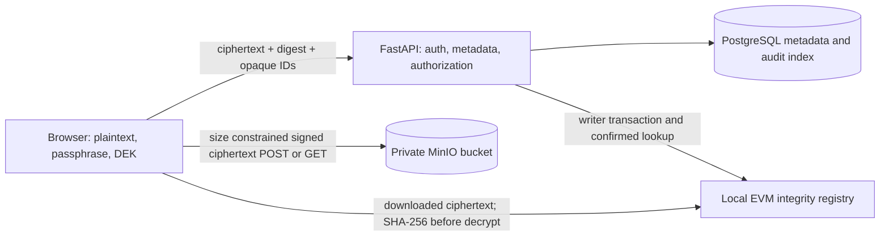

# Architecture and trust boundaries

The browser encrypts every version with Web Crypto AES-GCM. Its key backup wraps a random master key using a passphrase-derived PBKDF2-HMAC-SHA-256 KEK. Each file DEK is wrapped under that master key and the encrypted wrapper is stored by the API with its version. The API also stores only the encrypted master-key backup (salt, iterations, nonce and wrapped bytes). Signing in does not unlock data; the user must enter the key passphrase. The same backup can be unlocked from another browser.

The API checks ownership before issuing URLs, stores opaque server-generated object keys, constrains signed upload policy to the declared size, reads ciphertext to confirm the declared size and SHA-256 before anchoring, registers only `keccak256(file UUID)`, `keccak256(version UUID)`, and ciphertext SHA-256, reads the registry back, and only then marks a version ready. A retry after a transaction but before database commit first checks the chain record and remains idempotent. Integrity lookup uses the configured chain directly. API version records are indexed application state, not the anchor of truth.

## Format and limits

`SCFS | 0x01 | 12-byte AES-GCM nonce | ciphertext || 16-byte GCM tag`. The SHA-256 is over exactly this envelope. AES-GCM authenticates the ciphertext; the chain digest is checked before key unwrap/decryption. UI limits plaintext files to 100 MiB, keeps the full plaintext/ciphertext in browser memory, and revokes object URLs after download.

## Threat model summary

Protect file contents and encryption keys from the API, database, object store, and unauthorized users. Treat object storage as untrusted for integrity. The MVP handles network/storage tampering by checking the chain digest and GCM tag; ownership checks prevent a second account from obtaining metadata or URLs. Authentication uses Argon2id password hashes and short-lived bearer access tokens.

Out of scope: browser/device compromise and XSS, stolen credentials, malicious authorized users, lost passphrases, availability attacks, cloud account compromise, chain reorganization/finality beyond local development, and proof of lawful ownership or benign contents. Public immutable digests can reveal access patterns; random identifiers only reduce direct identity leakage. Revocation, sharing, recovery, multiple providers, and anomaly detection are not implemented. Blockchain does not prevent object deletion or denial of service. Local chain results are not representative of public chain fees or latency.

Production gaps: use TLS and secure refresh/session cookies, deploy a reviewed recovery/envelope encryption design, move the process-local authentication limiter to a shared store, add account lifecycle controls, versioned Alembic migrations and reconciliation/retention jobs, proxy-aware signed URLs, strict response headers, key lifecycle policy, backups, monitoring, and security review. Never use the included development signer or local passwords in production.
